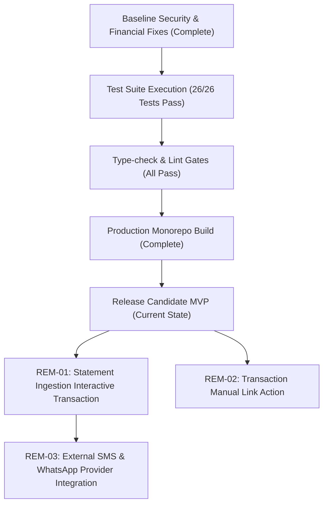

# SubGuard — Remediation Plan

## 1. Overview & Remediation Philosophy

This plan details the resolution status of findings discovered during the comprehensive audit of **SubGuard**, prioritizes remaining technical debt, and outlines the dependency sequence required for ongoing release readiness.

SubGuard operates under a non-custodial, explainable, and zero-float financial tracking model. Fixes prioritized below focus on ensuring zero cross-tenant leakage, exact integer arithmetic, deterministic recurrence candidate generation, and reliable user controls.

---

## 2. Release Blockers (Status: Resolved)

The following items were identified as critical blockers for MVP deployment and have been remediated in the codebase with passing regression tests:

| ID | Title | Severity | Impact | Resolution Summary | Regression Test |
|---|---|---|---|---|---|
| **SEC-01** | Cross-tenant IDOR in Mandate Association | P1 | Unauthorized linkage of foreign commitments | Validated `commitment.userId === requestingUser.id` in `MandateService.create` and `update` | `apps/api/src/modules/auth/auth.security.test.ts` |
| **SEC-02** | Cross-tenant IDOR in Reminder Dispatch Scheduling | P1 | Unauthorized creation of reminders against foreign commitments | Validated `commitment.userId === requestingUser.id` in `NotificationService.createReminder` | `apps/api/src/modules/auth/auth.security.test.ts` |
| **FIN-01** | Multi-cycle Lookahead Undercounting | P1 | Weekly & bi-weekly obligations undercounted in 7-day/30-day cashflow forecasts | Iterative forward date accumulation using `getNextDueDate` within time horizon in `InsightsService` | `apps/api/src/modules/insights/insights.test.ts` |
| **DET-01** | Duplicate Candidate Generation on Re-analysis | P2 | Dismissed candidates repeatedly resurfacing to user | Extended candidate query filter to exclude both `CONFIRMED` and `DISMISSED` candidates in `DetectionService` | `apps/api/src/modules/detection/detection.engine.test.ts` |
| **PWA-01** | Missing PWA App Icons | P2 | Web app manifest failure on home-screen install | Generated compliant PNG icons (`icon-192.png`, `icon-512.png`) featuring SubGuard brand shield | Asset verification & Next.js static asset build |

---

## 3. Prioritized Backlog (Post-MVP Enhancements)

The following enhancements represent improvements identified during the audit that do not block MVP release but should be scheduled in subsequent sprints.

### Priority 2 (Medium) — Next Release Cycle

#### REM-01: Statement Upload Atomic Reversal & Rollback UI
- **Description:** Currently, if a statement import encounters an unrecoverable batch write failure, transactions already written within a completed chunk might remain partially recorded in PostgreSQL.
- **Acceptance Criteria:**
  - Wrap chunked statement transaction ingestion in a dedicated multi-chunk Prisma interactive transaction `$transaction(async (tx) => { ... }, { timeout: 30000 })`.
  - Provide a single-click "Revert Import" button on `/imports` that cascades transaction deletions by `importBatchId`.
- **Target Files:**
  - `apps/api/src/modules/import/import.service.ts`
  - `apps/web/src/app/imports/page.tsx`
- **Dependencies:** None.

#### REM-02: Interactive Transaction-to-Commitment Manual Linking
- **Description:** Currently, transactions link to commitments during detection or auto-match heuristics. A user cannot currently select an unlinked transaction from `/transactions` and manually map it to an existing commitment via the UI.
- **Acceptance Criteria:**
  - Add API endpoint `POST /api/v1/transactions/:id/link` accepting `{ commitmentId: string }`.
  - Add "Link to Subscription" modal action on transaction table rows.
  - Recalculate last payment date and amount for the target commitment.
- **Target Files:**
  - `apps/api/src/modules/transaction/transaction.controller.ts`
  - `apps/web/src/app/transactions/page.tsx`
- **Dependencies:** `apps/api/src/modules/transaction/transaction.service.ts`.

---

### Priority 3 (Low) — Polish & Operational Hardening

#### REM-03: WhatsApp & SMS Integration Connectors
- **Description:** Implement webhook/queue workers for external notification providers (e.g., Gupshup, Twilio, or MSG91) when in-app alerts are insufficient for the user.
- **Acceptance Criteria:**
  - Implement dead-letter queues (DLQ) in BullMQ for failed SMS/WhatsApp delivery attempts.
  - Honor user notification channel preferences (`inApp`, `email`, `whatsapp`).
- **Dependencies:** Redis cluster and external SMS provider credentials.

#### REM-04: Automated Database Backup & Point-in-Time Recovery (PITR)
- **Description:** Set up automated WAL archiving and pg_dump snapshot cron jobs for PostgreSQL in production environments.
- **Acceptance Criteria:**
  - Backup scripts with encrypted S3/GCS offsite uploads.
  - Tested restore playbook verified in staging.
- **Dependencies:** Production cloud infrastructure.

---

## 4. Implementation Dependency Sequence



---

## 5. Verification Commands

To revalidate all release gates after any future modifications:

```bash
# 1. Verify TypeScript types across all 7 packages and apps
pnpm type-check

# 2. Verify linting and static compiler checks
pnpm lint

# 3. Execute all 26 automated unit and security tests
pnpm test --force

# 4. Verify Prisma schema and migration consistency
pnpm --filter @subguard/database prisma migrate status

# 5. Build production artifacts for Next.js web app and NestJS API
pnpm build
```

---

## 6. Explicitly Out-of-Scope (Future Releases)

The following capabilities are strictly outside the SubGuard MVP boundary and must not be promised to users:

1. **Automated Bank Scraping:** Storing netbanking passwords, UPI PINs, or reverse-engineering consumer banking APIs.
2. **Direct Money Movement:** Debiting accounts, settling bills, or moving funds.
3. **Automated Mandate Revocation Without User Intervention:** Revoking an NPCI/e-mandate directly on bank rails without user biometric/OTP authentication in their bank's portal.
4. **Black-box AI Auto-Approvals:** Approving recurrence candidates without user review and confirmation.
